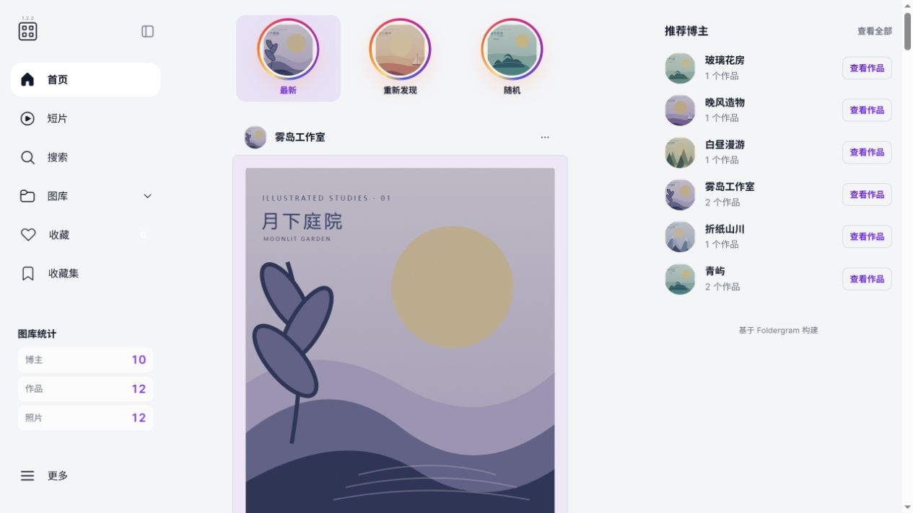
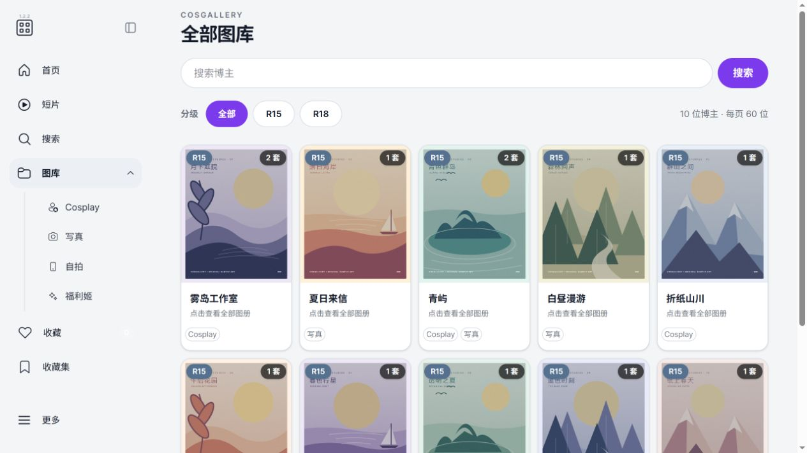
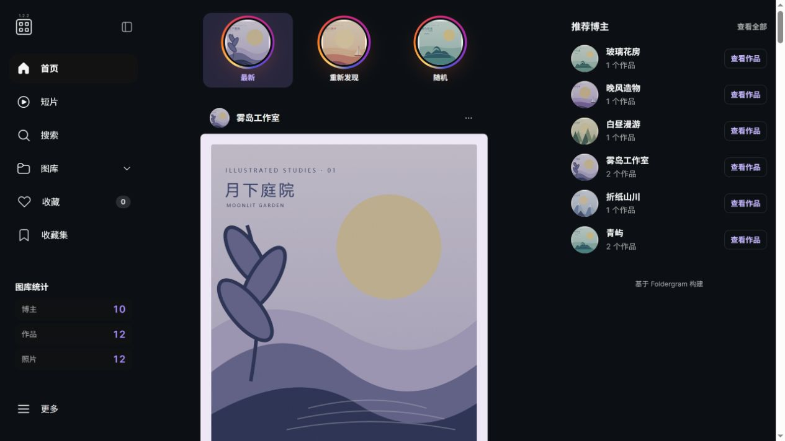
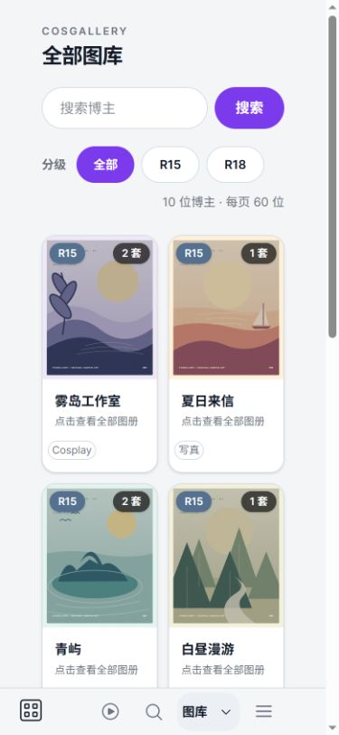

<div align="center">


<h1>CosGallery</h1>

<p><strong>把散落在硬盘里的图集，整理成自己的图库。</strong></p>
<p>按博主发现作品，浏览照片与视频，在网页中完成收录和整理。<br>本地资源先入库，来源资料慢慢补。</p>

<p>
  <a href="LICENSE"></a>
  <a href="docs/installation.md"></a>
  <a href="package.json"></a>
</p>

<p>
  <a href="docs/quick-start.md"></a>
  <a href="docs/index.md"></a>
  <a href="https://github.com/Brilliant666/CosGallery/issues"></a>
</p>

<p><a href="#界面预览">界面预览</a> · <a href="#核心能力">核心能力</a> · <a href="#本机运行">本机运行</a> · <a href="#文档导航">文档导航</a></p>

</div>

## 界面预览

从最新作品开始，也可以重新发现旧作，或随机遇见一套喜欢的图集。



<details>
<summary><strong>展开查看更多界面：博主图库 · 深色模式 · 手机浏览</strong></summary>

### 按博主浏览

一位博主、一张卡片。用分类找到想看的内容，再进入作品列表。



### 深色模式

相同的浏览方式，在浅色和深色主题中保持一致。



### 手机浏览

用底部导航切换页面，继续浏览博主与作品。

<p align="center"></p>

</details>

<sub>以上为当前真实界面，使用虚构博主、原创插画封面和演示数据拍摄；不包含私人图库资料。截图范围与素材说明见 <a href="docs/images/readme/ASSETS.md">预览素材说明</a>。</sub>

## 核心能力

| 能力 | 你可以做什么 |
| :--- | :--- |
| **🗂️ 按博主发现作品** | 在 Cosplay、写真、自拍、福利姬四个分类中浏览；支持名称和别名搜索，一位博主可以有多个标签。[图库指南](docs/features.md) |
| **🖼️ 照片与视频一起看** | 照片使用缓存预览，图集视频原件优先、按需兼容；短片同时收录独立视频和图集内视频。[媒体处理](docs/media-processing.md) |
| **📥 在网页中收录** | 选择已解压作品，核对博主、已有作品和附件，再确认入库；进度与异常保留在原任务中。[本地入库](docs/local-admission-web.md) |
| **📚 整理自己的资源目录** | 按独立作品编目、搜索和导出；多个本地副本和来源资料关联到作品，避免混淆计数。[资源目录](docs/own-resource-catalog.md) |
| **♻️ 按范围回收** | 单张详情回收当前媒体，资源目录回收整个独立作品及其副本；恢复与永久删除分别核对范围。[回收与删除](docs/album-media-deletion-design.md) |
| **🎨 按习惯浏览** | 切换浅色或深色；管理员可设置全站强调色，并为当前浏览器选择点击或悬停侧栏。[外观与配置](docs/configuration.md) |

全部图库保留 R15 / R18 筛选，四个分类页不叠加分级；博主的“喜欢 / 保留”仅供管理员整理。公开访客能否浏览，由站点访问设置决定。[页面地图](docs/creator-admission-navigation.md) · [访问权限](docs/security.md)

## 从本地资源开始

**准备图集 → 网页核对 → 确认入库 → 浏览作品**

手工复制或解压完成后，进入 **博主入库 → 本地入库**，选择等待区中的博主和独立作品目录。来源资料不是必填项，普通操作不需要手写 JSON 或运行维护 CLI。复杂合集需要先明确作品边界；相似标题只是候选，不会自动证明是同一套。

已移动范围和异常回到所属原计划处理，已完成项不重跑。[本地入库与审核](docs/local-admission-web.md)

<details>
<summary><strong>已有 Costuan 来源？查看可选的补缺路径</strong></summary>

检查来源 → 网盘暂存 → 用户通过百度客户端下载 → 本机检查、解压与入库。

**网盘已暂存 ≠ 本地已下载 ≠ 已入库。** 不能用来源套数与本地套数的差值直接推定缺失。

[Costuan 操作指南](docs/local-ingest-closed-loop.md) · [来源资料与对应](docs/source-evidence-local-admission.md)

配套的 [CostuanArchiveManager](https://github.com/Brilliant666/Script/tree/main/CostuanArchiveManager) 是独立扩展，负责来源与暂存协作，不随图库自动安装或重载。

</details>

**CosGallery Companion** 提供独立的浏览辅助，使用可撤销、会到期的专用只读授权。它不随图库自动安装或重载，也不会因资料同步自动入库。[Companion 只读连接](docs/companion-readonly-api.md)

## 本机运行

推荐 **Node.js 24.21.0 · pnpm 10.28.0**。视频处理需要 FFmpeg / FFprobe；Costuan 压缩包入库另需配置可信的 7-Zip。Windows 本机是目前重点验证环境，完整要求见[安装指南](docs/installation.md)。

下面是首次安装的 PowerShell 示例：

```powershell
git clone https://github.com/Brilliant666/CosGallery.git
cd CosGallery
pnpm install --frozen-lockfile
Copy-Item .env.example .env
```

**启动前先编辑 `.env`**：保留 `COS_GALLERY_MODE=1`，核对图库、数据库和缓存路径；已有配置不要覆盖，测试不要指向真实图库。已有索引时通常跳过启动扫描，空索引首次启动会扫描；`LOCAL_INGEST_STARTUP_SCAN=false` 只关闭 Costuan 启动补偿扫描。[配置说明](docs/configuration.md)

```powershell
pnpm build
pnpm start
```

启动完成后访问 **[http://127.0.0.1:4141](http://127.0.0.1:4141)**。后端提供配套前端，并执行必要迁移与校验。升级已有实例先按[升级说明](docs/installation.md#升级现有实例)核对候选验证与恢复材料；开发端口见[开发指南](docs/development.md)。

## 数据由自己掌握

- **身份与副本分开管理。** 博主是人物身份，Work 是独立作品，LocalWork 是本地副本；同名、编号或文件数不能自动证明同套。[数据原理](docs/how-it-works.md)
- **原件与缓存分开保存。** 入库会按确认计划移动目录；应用回收、Windows 回收站和永久删除各有不同边界。保留的未支持原件不等于已成功解码。[排错与恢复](docs/troubleshooting.md)
- **恢复点不包含原媒体。** 应用恢复点保护数据库、必要配置与本地密钥，图库原件需要另行备份。[应用恢复点](docs/application-recovery-points.md)

<details>
<summary><strong>使用边界与后续方向</strong></summary>

- 本机后端只能操作它能访问的磁盘；远端部署不会自动访问浏览器用户的本地盘符。跨卷、NAS 和其他系统不能视为已完成同等入库 / 回收验收。
- 不自动拆分混乱合集，也不提供任意已有 Work 合并。删除博主需先停用，并通过本地作品、目录与关联核验。[删除博主](docs/unused-manual-creator-deletion.md)
- 仓库中的 Docker / Compose 和上游在线演示不代表已验收的完整 CosGallery 部署。
- 当前不是已经完成公网加固和多用户隔离的云端图库。Cloudflare R2 派生图发布、原作 / 角色 / 主题发现仍是后续讨论方向。
- 首次编目、完整性校验和首次派生图生成受数据及设备影响，没有固定耗时承诺。

</details>

## 文档导航

| 开始使用 | 日常管理 | 维护与开发 |
| :--- | :--- | :--- |
| [快速开始](docs/quick-start.md) | [本地入库与审核](docs/local-admission-web.md) | [常见问题](docs/faq.md) |
| [安装与升级](docs/installation.md) | [资源目录](docs/own-resource-catalog.md) | [排错与恢复](docs/troubleshooting.md) |
| [功能与页面地图](docs/creator-admission-navigation.md) | [来源与 Costuan](docs/local-ingest-closed-loop.md) | [开发指南](docs/development.md) |
| [配置与访问权限](docs/configuration.md) | [回收与删除](docs/album-media-deletion-design.md) | [运行治理](docs/governance-runtime.md) |

[全部文档](docs/index.md) · [维护与历史参考](docs/reference-index.md) · [贡献约定](CONTRIBUTING.md)

## 开源与致谢

基于 [Foldergram](https://github.com/foldergram/foldergram) 构建，感谢 **Sajjad Ali** 及上游贡献者。沿用并扩展 Vue、Express、SQLite 与本地媒体处理能力，保留上游署名与 **[AGPL-3.0](LICENSE)** 许可证。

<sub>功能说明按已合并 PR52（4c56531）核对。源码、已安装产物和运行服务可能处于不同版本；文档更新不代表自动部署。<a href="docs/evidence/pr52-documentation-refresh.md">核对记录</a></sub>
