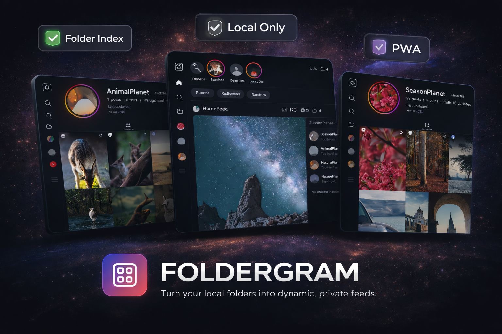

<div align="center">

<a href="https://foldergram.intentdeep.com/">
  
</a>
<br /><br />
<a href="https://foldergram.intentdeep.com/">
  
</a>

# Foldergram

**Local-only photo and video gallery for folders, with an Instagram-inspired browsing pattern.**

[](https://github.com/foldergram/foldergram/pkgs/container/foldergram)
[](https://foldergram.intentdeep.com/)
[](https://nodejs.org/)
[](https://vuejs.org/)
[](https://www.gnu.org/licenses/agpl-3.0)

[Live Demo](https://foldergram.intentdeep.com/) • [Features](#features) • [Installation](#installation) • [Configuration](#configuration) • [Tech Stack](#tech-stack) • [Contributing](CONTRIBUTING.md)

**Try the public demo:** [foldergram.intentdeep.com](https://foldergram.intentdeep.com/)

</div>

---

## CosGallery adaptation

This repository is the creator-focused CosGallery build. With `COS_GALLERY_MODE=1`, the filesystem hierarchy is interpreted as:

```text
GALLERY_ROOT/
  Creator/
    Album/
      photo-or-video
```

- The original Foldergram home feed and navigation remain available.
- **Library** shows one card per creator; selecting a creator opens all of that creator's albums.
- A creator cover uses the first image from the newest album that contains photos, so a newer video-only album does not replace the photo cover.
- CosGallery's database is the sole canonical creator roster and rating authority. R15/R18 and nullable preference are independent creator metadata, not inferred from albums.
- The **博主库** section in `/archive-catalog` manages all creators (including creators without media): create, rename, manual aliases, nullable preference/rating, deactivate/restore, and explicit local-folder links. No hard delete, media changes or automatic task execution.
- HentaiClub initialized the first roster historically and is now retired. Historical sources/aliases/import records are retained; there is no JSON import, sync or bootstrap command. Costuan may update source/collection/work metadata, never canonical names/preferences/ratings.
- **我的图库** displays only local media folders and reads classification through `folders.id → archive_catalog_local_creator_folders.gallery_folder_id → creator_id → archive_catalog_creators`. Unlinked folders and linked-but-unclassified creators are distinct; inactive creators are hidden by default but remain accessible.
- Migration 000016 adds activation and the persistent Folder bridge, snapshots the already-stored seed metadata and checks legacy manual ratings. The existing migrate/startup command performs exact full-path backfill with Windows normalization; conflicts are reported, not guessed. Its persisted completion marker prevents legacy values overriding subsequent edits. Back up before upgrading; do not run old code against the upgraded database.

- Album cover labels come from `CostuanArchiveManager` metadata, not from album folder names. Export `costuan-archive-*.json` from the extension and import it with:

```bash
pnpm --dir server import:costuan-archive "path/to/costuan-archive.json"
```

### Archive catalog and read-only reconciliation

CosGallery keeps the canonical `archive_catalog_creators` alongside Foldergram's physical media index. The roster exists before local media does: 17 Costuan works and 13 local works means four missing works, not four missing creators.

Create or edit creators in **博主库** first. Use Stage 1 to acquire Costuan metadata and explicitly initiate a gallery scan when local files have changed. Existing source IDs and manual Folder links remain authoritative after a rename. Unknown or ambiguous Costuan names remain unassociated instead of creating or merging creators.

For controlled runtime activation, set `LOCAL_INGEST_STARTUP_SCAN=false` in the process environment to skip automatic Stage 3 inbox discovery at startup. The default is `true` (also accepts `1`/`0`); invalid values fail configuration validation. This switch does not change the saved allowlist, manual discovery/run actions, interrupted-job recovery, or the separate gallery startup-scan policy. It does not run or resume ingestion jobs.

Future metadata/download planning excludes inactive creators without deleting, cancelling, requeuing or reconciling their existing tasks. Restoring a creator does not itself plan tasks. Source identities and source-derived aliases are read-only in the roster; renamed canonical names become historical aliases.

See [managed roster and rating bridge evidence](docs/evidence/cosgallery-managed-creator-roster-and-rating-bridge-v1.md) for migration checks, API behavior and isolated validation.

### Local-only creator metadata queue

After a gallery scan, CosGallery now identifies creators that already have active folders under `GALLERY_ROOT` but still have no active Costuan works in the archive catalog. These creators are planned into a separate, durable metadata queue. `CostuanArchiveManager` claims the queue, reuses its existing Costuan search and Baidu-save workflow, and posts each completed Costuan record directly back to the loopback bridge. Normal “not found” results are recorded separately from automation failures.

The extension finalizes the batch once, after every claimed creator has reached a terminal state. Finalization performs one read-only reconciliation of `G:\cos图集`, writes the updated report, and then refreshes the missing-work download queue. This prevents a full local reconciliation after every creator and removes the old manual export/import step.

### Missing-work download queue

The second-stage bridge turns reconciled Costuan gaps into an idempotent download queue. In `/archive-catalog`:

1. Keep the Chrome default download directory at `G:\cos待入库`.
2. Generate all missing tasks, or generate tasks for one creator from their expanded details.
3. Generate a one-time plugin connection token and paste it into `CostuanArchiveManager`.
4. Connect the extension to `http://127.0.0.1:4141`, then start automatic staging.

Only creators already present in the read-only `G:\cos图集` reconciliation are eligible. For those creators, active Costuan works that are absent locally and have a successful Baidu delivery record are queued. Every task stores the stable Costuan source order, saved Baidu folder, and an isolated target such as `G:\cos待入库\rua阮阮\014.7z`. Re-generating the plan does not duplicate existing tasks, and inactive creators' existing tasks remain untouched.

The local bridge is bound to loopback access and authenticated with a generated token. The token is shown once; generating another token invalidates the previous one. The extension claims all missing works for one creator, creates or reuses `我的网盘/cos待入库/<creator ID>`, traverses Baidu's virtualized source list, selects the exact missing archives, and copies them as one batch. It verifies the target folder before reporting `staged`, then continues with the next creator. `staged` means the archives are present in the Baidu inbox; it does not mean they have been downloaded, extracted, or ingested into the local gallery.

The accepted baseline workflow, status semantics, safety boundaries, and the 2026-08-31 milestone snapshot are recorded in [docs/cosgallery-basic-pipeline.md](docs/cosgallery-basic-pipeline.md).

The importer associates albums by Costuan's stable `sourceOrder` (`NO.001`, `NO.002`, and so on), then persists the creator ID plus `works[].label` in SQLite. Full folder names, media-count summaries, and archive sizes are not used as visible labels.

Use `PUBLIC_DEMO_MODE=1` when the media tree must remain read-only. In CosGallery mode, creator rating updates still write only to the SQLite metadata database.

Foldergram is a self-hosted web application that turns your local folders into a beautiful, instagram-style feed and profile. It turns your local folder to app folders (profiles), and serves a lightning-fast Progressive Web App (PWA).

Foldergram indexes supported media from a configured `GALLERY_ROOT`, stores metadata in SQLite, generates thumbnails and previews, and serves a fast feed-style web app for local browsing. Derivatives can be generated during scans or lazily on first request, and image detail pages can be configured to use generated previews or originals. The current app includes Home, Reels, Explore, Library, Likes, Moments or Highlights, App Folder pages, post detail views, original-media download controls, delete actions, scan controls, and rebuild tools.

Generated derivatives are now stored under stable asset-key shards instead of mirroring source folders. Existing libraries stay readable during upgrade, then migrate in place on the next full scan. During that upgrade, Foldergram keeps stored paths pointed at files that already exist, repairs surviving legacy derivatives where possible, and lets later folder moves preserve the same indexed media identity and reuse existing thumbnails/previews. Scan status distinguishes discovery, derivative migration, and derivative generation so long-running maintenance work can report the right kind of progress for each phase.

## Features

- **Instagram-Inspired UI:** Enjoy a familiar feed layout, dedicated app folders (profiles), and a media viewer.
- Home feed with `Recent`, `Rediscover`, and `Random` modes.
- A dedicated `/reels` route with a video-only queue. Settings can default it to `Recommended`, `Recent`, or `Random`.
- A top rail that shows `Moments` when capture-date coverage is strong, or `Highlights` when it is not.
- Library browsing with App Folder search, sorting, and delete actions.
- App Folder pages with a posts grid and a folder-specific `Reels` tab when videos exist.
- Shared likes in SQLite for signed-in admin/viewer sessions, plus browser-local favorites in public mode.
- Image and video support with configurable eager or lazy derivative generation for fast browsing.
- Original-media download controls on home feed cards, post detail, and stories, alongside open-original actions.
- Optional role-based local access with admin, viewer, and public browse modes.
- Settings split into `General Settings` for Home/Reels defaults, language selection, stories and carousel folder modes, and excluded folders, plus `Scan & Library` for scan and rebuild actions.
- Phase-aware scan progress for first indexing, derivative migration, and rebuilds.
- A web app manifest plus production service worker registration.
- A debounced filesystem watcher in development mode only.
- No multi-user accounts, cloud sync, uploads, comments, messaging, notifications, or remote APIs.

## How It Works

Foldergram maps directly to your filesystem:

1. **App Folders:** Any non-hidden folder under `GALLERY_ROOT` that directly contains supported media becomes one indexed App Folder. In reserved carousel mode, a folder also qualifies when its `carousels/` directory has an immediate child containing supported media directly.
2. **Posts:** Each supported image or video directly inside an App Folder becomes one indexed post. Media in `AppFolder/carousels/Post name/` is grouped into a carousel post in reserved mode.
3. **Nested folders stay separate:** Nested local folders are not merged into their parent App Folder. If a nested folder directly contains supported media, it becomes its own App Folder with parent folder name in the route (e.g. /folder/parent-nested).
4. **Root files are ignored:** Files placed directly in `GALLERY_ROOT` are ignored.

Runtime reads come from SQLite and generated derivatives, not from live filesystem scans on every request.

### Supported Formats

- **Images:** `.jpg`, `.jpeg`, `.png`, `.webp`, `.gif`, `.avif`
- **Videos:** `.mp4`, `.mov`, `.m4v`, `.webm`, `.mkv`

Animated image files keep animation in the post viewer preview and home feed cards. Folder/profile grids and other thumbnail surfaces remain static. Static AVIF files stay on the normal image pipeline; animated AVIF image sequences generate static WebP thumbnails and animated WebP previews.

For source installs, video support and animated AVIF image-sequence processing require `ffmpeg` and `ffprobe`. The Docker image installs them inside the container.

## Installation

### 🐳 The Easy Way (Docker - Recommended)

This is the recommended path for most users. It uses the pre-built GitHub Container Registry (GHCR) image.

1. Create a folder for Foldergram and move into it:

```bash
mkdir foldergram
cd foldergram
```

2. Download the Compose file:

```bash
wget -O docker-compose.yml https://raw.githubusercontent.com/foldergram/foldergram/main/docker-compose.yml
```

3. Create your first gallery folder:

```bash
mkdir -p data/gallery/example-album
```

4. Move a few photos or videos into `data/gallery/example-album/` to create your first indexed App Folder.
5. Start the container:

```bash
docker compose up -d
```

Container startup runs pending SQLite migrations automatically before the app
opens the library database.

6. Open `http://localhost:4141`.

In Docker, Foldergram runs in production mode and the app inside the container listens on `4141`. If you need a different host port, change the left side of `4141:4141` in [`docker-compose.yml`](docker-compose.yml).

For the default Docker Compose setup, the container uses the image's built-in
production defaults plus the mounted `./data/...` volumes. The source-install
`.env` file is not read inside the container unless you wire that in yourself.

The shipped Compose file includes `IMAGE_DETAIL_SOURCE: preview` and
`DERIVATIVE_MODE: eager`.

If you want lazy derivatives or original-backed image detail pages in Docker,
edit those values in `docker-compose.yml` before starting the container.

If you want Docker to skip unwanted source folders from the first scan, add
`GALLERY_EXCLUDED_FOLDERS` under the Compose `environment:` block. For example:

```yaml
GALLERY_EXCLUDED_FOLDERS: "@eaDir,thumbnails,Archive/cache"
```

For an optional read-only public demo in Docker, add `PUBLIC_DEMO_MODE: "1"`
under the Compose `environment:` block. If the browser-visible origin differs
from the upstream Node host, also set `CSRF_TRUSTED_ORIGINS` to that public
origin.

### If You Already Cloned This Repository

The repository includes:

- [`docker-compose.yml`](docker-compose.yml) for the GHCR image
- [`docker-compose.local.yml`](docker-compose.local.yml) as a local-build override

To build locally from source instead of pulling from GHCR, run:

```bash
docker compose -f docker-compose.yml -f docker-compose.local.yml up -d --build
```

This command uses the same runtime settings and volumes, but builds the image locally from the repository `Dockerfile`.

### Run from Source

> **Note:** This repository is set up as a workspace. **`pnpm` is preferred** for the best development experience, but standard `npm` is also supported if you prefer the default Node toolchain.

Requirements:

- Node.js 22
- `npm` or `pnpm`
- `ffmpeg` and `ffprobe` if you want video support or animated AVIF image-sequence processing outside Docker

1. Clone the repository:

```bash
git clone https://github.com/foldergram/foldergram.git
cd foldergram
```

2. Create your local env file:

```bash
cp .env.example .env
```

3. Install dependencies:

```bash
pnpm install
# or
npm install
```

4. Start the development workspace:

```bash
pnpm dev
# or
npm run dev
```

`pnpm dev`, `pnpm dev:server`, and `pnpm start` now run versioned SQLite
migrations automatically before the server boots. Use `pnpm migrate` if you
want to apply pending migrations without starting the app.

On the first start after upgrading from an older supported Foldergram release,
the app automatically baselines the existing SQLite database and then applies
later ordered migrations on future upgrades.

Development ports:

- Client: prefers `http://localhost:4141` and automatically uses the next free port up to `4144`
- API: `http://localhost:4140`
- Docs: `http://localhost:4145`

The Vite client stays within the reserved `4141-4144` range in development, so it can move off `4141` without colliding with the API or docs ports.

If you only want part of the workspace, use:

- `pnpm dev:server`
- `pnpm dev:client`
- `pnpm dev:docs`

For a production build from source:

```bash
pnpm build
pnpm start
# or
npm run build
npm start
```

Then open `http://localhost:4141`.

## Configuration

Default paths come from [`.env.example`](.env.example):

```text
data/
  ├─ gallery/       # Original source media
  ├─ db/
  │   └─ gallery.sqlite
  ├─ thumbnails/    # Generated thumbnails and poster images, sharded by asset key
  └─ previews/      # Generated previews, sharded by asset key
```

`GALLERY_ROOT` only needs read access. `DB_DIR`, `THUMBNAILS_DIR`, and
`PREVIEWS_DIR` must be writable. `<DATA_ROOT>/scan-errors` is created on
demand and must be writable when skip mode produces scan reports.

| Variable                      | Default             | Description                                                               |
| ----------------------------- | ------------------- | ------------------------------------------------------------------------- |
| `NODE_ENV`                    | `development`       | Runtime mode.                                                             |
| `SERVER_PORT`                 | `4141`              | Production Express port.                                                  |
| `DEV_SERVER_PORT`             | `4140`              | Express server port during `pnpm dev`.                                    |
| `DEV_CLIENT_PORT`             | `4141`              | Base Vite client port during `pnpm dev`. The client may use up to `4144`. |
| `DATA_ROOT`                   | `./data`            | Root directory for app-managed storage.                                   |
| `GALLERY_ROOT`                | `./data/gallery`    | Root directory scanned for App Folders.                                   |
| `GALLERY_EXCLUDED_FOLDERS`    | empty               | Comma-separated folder exclusion rules such as `@eaDir,Archive/cache`.    |
| `DB_DIR`                      | `./data/db`         | SQLite database directory. Startup migrations target `<DB_DIR>/gallery.sqlite`. |
| `THUMBNAILS_DIR`              | `./data/thumbnails` | Generated thumbnail output directory.                                     |
| `PREVIEWS_DIR`                | `./data/previews`   | Generated preview output directory.                                       |
| `FFMPEG_PATH`                 | `ffmpeg`            | FFmpeg executable name or absolute path.                                  |
| `FFPROBE_PATH`                | `ffprobe`           | FFprobe executable name or absolute path.                                 |
| `FFMPEG_VIDEO_ENCODER`        | `libx264`           | Video preview encoder. Use `h264_nvenc` for an NVENC-capable FFmpeg build. |
| `IMAGE_DETAIL_SOURCE`         | `preview`           | For image detail pages, use generated previews or stream originals.       |
| `DERIVATIVE_MODE`             | `eager`             | Generate derivatives during scans or lazily on first request.             |
| `LOG_VERBOSE`                 | `0`                 | Truthy values are `1`, `true`, `yes`, and `on`.                           |
| `SCAN_MEDIA_ERROR_MODE`       | `skip`              | Use `skip` to report supported-media failures and continue, or `fail`.    |
| `SCAN_DISCOVERY_CONCURRENCY`  | `4`                 | Folder discovery concurrency.                                             |
| `SCAN_DERIVATIVE_CONCURRENCY` | `4`                 | Derivative generation concurrency.                                        |
| `PUBLIC_DEMO_MODE`            | `0`                 | When enabled, all API mutations become read-only and return `403`.        |
| `CSRF_TRUSTED_ORIGINS`        | empty               | Comma-separated extra browser origins allowed for mutating API requests.  |

`DATA_ROOT` is the base path for the app's local storage layout. If you set
only `DATA_ROOT`, Foldergram will default the other storage paths to
`<DATA_ROOT>/gallery`, `<DATA_ROOT>/db`, `<DATA_ROOT>/thumbnails`, and
`<DATA_ROOT>/previews`. Set `GALLERY_ROOT`, `DB_DIR`, `THUMBNAILS_DIR`, or
`PREVIEWS_DIR` separately only when you need a non-standard layout.
Per-run full scan error reports are written under `<DATA_ROOT>/scan-errors/`
when a scan records supported-media failures.

Docker uses the fixed internal container port `4141`, and other production
runtimes continue to use `SERVER_PORT`, which defaults to `4141` in the Docker
image.

For the default Docker Compose setup, runtime variables are defined in
[`docker-compose.yml`](docker-compose.yml). The source-install `.env` file is
not read directly by the container.

### Excluded Folders

- Use `GALLERY_EXCLUDED_FOLDERS` to skip unwanted source folders during discovery and rescans.
- Rules without a slash match a folder name anywhere in the gallery tree, such as `@eaDir` or `thumbnails`.
- Rules with a slash match one exact relative folder path beneath `GALLERY_ROOT`, such as `Archive/cache`.
- The Settings sidebar separates app-wide preferences into `General Settings`. That section includes the instant language selector plus saved app-language default, stories and carousel folder modes, Home/Reels defaults, and the excluded-folder editor.
- `General Settings` can add or remove custom exclusion rules at runtime. Env-backed rules stay read-only there and still require a restart to change.
- After changing excluded folders, stories mode, or carousel mode in `General Settings`, follow the action shown in `Scan & Library` so indexed folders and posts are classified correctly. Run a full scan normally; use the index rebuild when the gallery location requires one.

### Detail Media and Derivative Timing

- `IMAGE_DETAIL_SOURCE=preview` keeps image detail pages on generated previews.
- `IMAGE_DETAIL_SOURCE=original` makes image detail pages stream `/api/originals/:id`.
- `DERIVATIVE_MODE=eager` generates thumbnails and previews during scans.
- `DERIVATIVE_MODE=lazy` indexes metadata during scans, then generates missing files the first time `/thumbnails/...` or `/previews/...` is requested and caches them on disk.
- `SCAN_MEDIA_ERROR_MODE=skip` reports supported image and video processing failures, skips those files, and lets the scan finish as `completed_with_errors`.
- `SCAN_MEDIA_ERROR_MODE=fail` preserves fail-fast behavior for those same scan-time media errors.
- When a scan records skipped media failures, Foldergram stores a short sample in SQLite, writes the full per-run report under `<DATA_ROOT>/scan-errors/`, and shows that report path in the admin Settings view.

These flags are independent:

- feed cards, folder grids, avatars, and other list surfaces still use generated derivatives
- `IMAGE_DETAIL_SOURCE` affects images only; videos still default to preview playback
- `Rebuild Library Index` refreshes the SQLite-backed index; in lazy mode it does not pre-generate missing derivatives
- `Regenerate Thumbnails` remains a manual thumbnail and video-poster rebuild only; it does not rebuild previews

### Access Protection

Access protection is configured from the Settings page, not from `.env`.

The current implementation supports:

- `admin` sessions with full access
- `viewer` sessions with shared likes but no Settings, Trash, scans, rebuilds, or delete actions
- `anonymous` public sessions with browse-only access and browser-local favorites
- `viewer_access_mode=off` for admin-only access
- `viewer_access_mode=password` for a separate viewer password
- `viewer_access_mode=public` for anonymous browsing plus admin unlock from `More`

Foldergram stores one-way password hashes plus signed session metadata in SQLite. In public mode, anyone who can reach the app can browse immediately, favorites stay in the current browser only, and admins can elevate back into full access from `More` with the admin password.

### Public Demo Deployments

To run Foldergram as a public read-only demo, set the following in `.env`:

```env
NODE_ENV=production
PUBLIC_DEMO_MODE=1
CSRF_TRUSTED_ORIGINS=https://foldergram.intentdeep.com
```

`PUBLIC_DEMO_MODE=1` blocks every `POST`, `PUT`, `PATCH`, and `DELETE` request
under `/api`, including future routes. `CSRF_TRUSTED_ORIGINS` is
only needed when the browser-visible origin differs from the upstream Node host seen by Express, such as behind a reverse proxy or HTTPS terminator.

## Tech Stack

**Backend**

- Node.js 22 + Express 5 + TypeScript
- SQLite via `node:sqlite`
- Sharp for image derivatives
- FFmpeg and FFprobe for video processing
- Chokidar for the development watcher
- Zod for runtime validation

**Frontend**

- Vue 3
- Vite
- Vue I18n
- Vue Router 4
- Pinia
- UnoCSS

**Workspace**

- `pnpm` monorepo

## Localization

Client translations live under `client/src/locales/`.

- `en.json` is the canonical source locale and the first place new UI copy should be added.
- `es.json` and `zh.json` are the shipped Spanish and Chinese translations for the client.
- `client/src/locales/index.ts` wires locale resolution and the Vue I18n runtime.
- `pnpm --filter @foldergram/client test` includes a locale validation test that checks locale keys against `en.json`.

## Scripts

- `pnpm dev`
- `pnpm dev:server`
- `pnpm dev:client`
- `pnpm dev:docs`
- `pnpm build`
- `pnpm migrate`
- `pnpm start`
- `pnpm test`
- `pnpm rescan`

## Contributing

Foldergram welcomes small, clearly aligned pull requests for bug fixes, documentation, tests, and focused polish.

Before working on major features, architectural changes, or changes to core behavior such as scanning, indexing, routing, auth or access flow, and storage strategy, open an issue or discussion first. Pull requests for large changes that were not discussed in advance will not be accepted.

See [CONTRIBUTING.md](CONTRIBUTING.md) for the full contribution policy, local setup notes, branch naming guidance, and pull request expectations.

## Carousel posts

Foldergram supports one post containing 2–20 ordered images, animated images, and videos. Put each post in `AppFolder/carousels/Post name/`; filename order controls its slides and the first item is its cover. A carousel counts as one post, has one caption, and its videos are excluded from Reels. The index stores visible posts separately from physical media through `posts` and `post_items`.

See [Posts with Multiple Photos or Videos](docs/carousel-posts.md) for the complete source tree, edge cases, settings, and troubleshooting guide.
