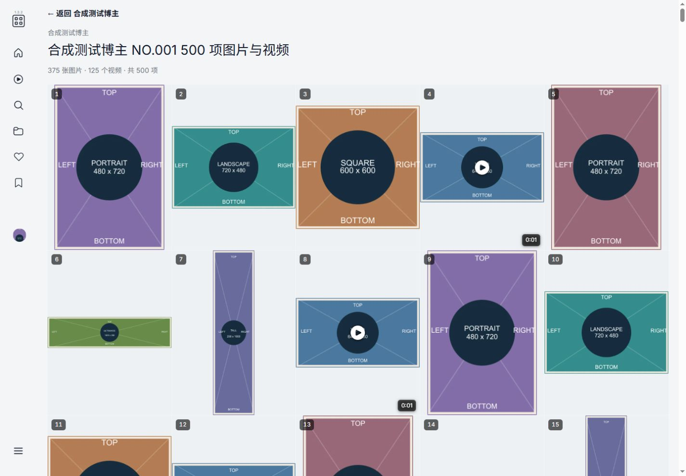
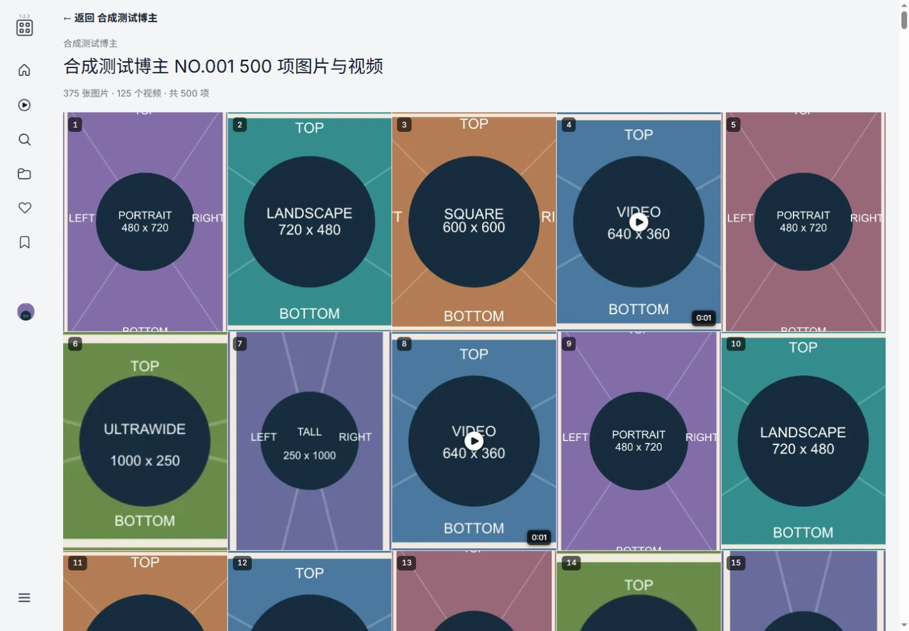
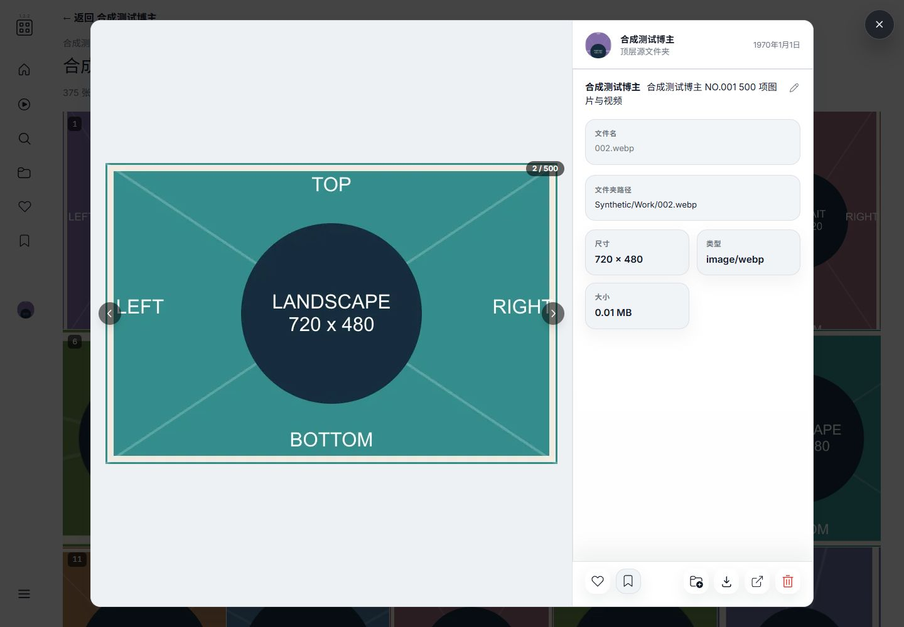
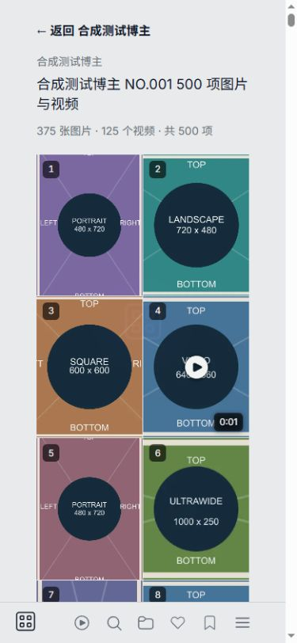

# CosGallery Work Gallery View V1 — evidence

Date: 2026-09-04 (Asia/Shanghai).
Base: `0a241b7566589e73e4b669cb941655e38c62f3bc`.
Branch: `feat/cosgallery-work-gallery-view-v1`.
Scope: browsing only; independent worktree and ordinary review PR. Do not merge or activate production as part of this task.

## 1. Audit of the existing implementation

Before: `/library` (creator directory) → `/f/:slug` (`FolderView`) → `FolderGrid` cover → `/post/:id` (`PostView` + `PostViewer`).

- `LibraryView` uses existing folder slugs to enter creator pages.
- The canonical viewer route is named `image`, despite its `/post/:id` URL; `/image/:id` is a client route alias.
- Folder feed card `id` is a Post ID. A Post's `mediaItems[].imageId` is the concrete file identity; those IDs need not equal the Post ID.
- API `/api/posts/:id` resolves a Post. The legacy API `/api/images/:id` resolves an Image and then its owning Post. These rules are unchanged.
- `/api/folders/:slug/images` supplies the existing cover, title, count and Post ID. `FolderGrid` is also used by likes, collections, place/moment and public-share pages; feed and search have their own entry components.
- App already renders a second `PostView` over a background route stored in `imageModalBackgroundPath`. It locks the body and restores its previous scroll on close. Existing Router tests covered basic modal scroll selection, but not the new nested work route, query-selected media, or a complete gallery → modal → back sequence.
- Server configuration `appConfig.cosGalleryMode` and folder role distinguish CosGallery normal creator folders from ordinary mode / internal carousel-source folders.

The existing Post detail already provides Post ID, folder slug/name, caption/carousel title/source path, post type/count and the complete position-ordered media list. Each media item includes Image ID, position, filename, media type, dimensions, duration, animation flag, thumbnail/preview/original URLs, MIME, size, relative path, playback strategy and EXIF. No parallel Work API or media model was needed.

Only the folder summary response gains a backward-compatible, read-only `workNavigationMode` enum. Its value is `work-gallery` for CosGallery normal folders, otherwise `post`; both preloaded and fallback summary paths are tested. No database migration or schema change.

## 2. Navigation and independent gallery

New chain: `/library` → `/f/:slug` → `/f/:slug/works/:postId` → `/post/:postId?media=:imageId&context=work`.

- `work-gallery` uses the existing Post ID, never the first Image ID or a newly introduced database ID.
- `FolderGrid.navigationMode` defaults to `post`. Only the creator `FolderView` explicitly passes the server-provided mode. Carousel type, media count and `showWorkLabels` do not opt a grid into the new navigation.
- Existing feed/search/likes/collections/place/share entry behavior stays unchanged. Shared routes take precedence even if a caller supplies the work mode.
- A single-media work still opens a one-card gallery.
- Invalid/non-positive/unsafe Post IDs are rejected before fetching. A mismatched folder slug renders the same fixed not-found state and no media. The existing Post API still rejects deleted/trashed/not-found Posts and enforces private-library authentication.
- Errors, empty lists, unavailable storage and missing posters are explicit states. Retry fetches only the Post or that failed card; it never scans or repairs data.

The new page shows a back-to-creator link, creator, work title and image/video/total counts. It has no new management sidebar or editing actions.

## 3. Media rendering and performance

Both gallery and viewer derive the same ascending `post_items.position` sequence. Images/videos are never grouped by type, extension, date or aspect ratio.

- Row-major CSS Grid, not CSS columns; 2/3/4/5/6 columns at mobile/640/1024/1280/1600 breakpoints.
- Stable Image ID keys; each card has an accessible link and a lightweight ordinal.
- All image thumbnails (including animated-image thumbnails) and video posters use the same fixed `3 / 4` slot, `overflow: hidden`, `object-fit: cover` and `object-position: center center`. This is CSS-only navigation-preview cropping, never rotation or a source-file conversion. The selected media in PostViewer remains complete with `object-fit: contain`.
- Cards have no persistent border, radius, shadow or outer white frame. The grid gap is `1px`; the keyboard-only `focus-visible` outline and failure/retry states remain available.
- On thumbnail failure only that image may fall back once to its non-original image preview. Video previews and originals are never used as thumbnail fallbacks.
- Videos show only a poster, play icon and duration. No grid video players or autoplay.
- A failed card has a local retry without replacing unaffected loaded cards.

### Initial PR 500-item browser regression (historical)

These are the original PR measurements. The current center-cover, mixed-orientation follow-up and its fresh measurements are in section 10.

Synthetic temporary dataset: 250 images + 250 videos in an alternating position sequence; both landscape and portrait images. A small synthetic video validates the existing player after selection.

At 1440 × 1000:

- 500 accessible media links; positions 1–500 in exact DOM order; five CSS grid columns.
- Initial grid requested/loaded **50 of 500** thumbnails using native browser lazy loading, **0 previews, 0 originals, 0 video players**.
- Longest observed initial-page task: **89 ms**; total reported long tasks **149 ms** (includes application boot). No multi-second blocking or console errors.
- All 500 cards were reachable by scrolling; items 1, 17, 18, 19, 251 and 500 were exercised.
- After traversing the full gallery, a warm reload exposed the first grid in **96.7 ms**, with longest task **68 ms**. This is a warm reload measurement, not a cold-load/network guarantee.
- At the last video, exactly one player was present; no next-item or next-Post link existed.
- Final counters after interaction: 500 thumbnails, 5 selected-media previews, 0 original requests. These are whole-session counts, not initial-load counts.
- At 390 × 844: two columns; no horizontal overflow; no CSS columns.

No virtualization was needed for this V1 sample. Browser timing is evidence from this machine, not a general performance SLA.

## 4. Viewer identity, actions and history

Reused components: `PostView`, `PostViewer`, `CarouselMediaStage`, `VideoMediaPlayer`. No second viewer.

- `media` stores the exact Image ID. Missing media selects the first item. Invalid/non-member/array/unsafe input selects the first and removes the invalid query with `router.replace`.
- Media switches update `query.media` with replace, not push. A page reload/deep link preserves the selected item.
- In `context=work`, outer Post neighbors are disabled. Buttons, keys, wheel and touch stay within the current work; bounds do not wrap to another Post. Normal feed modal cross-Post navigation is retained.
- Current filename, relative path, dimensions, MIME, duration, size, EXIF, original links and folder-cover target use the active media, including single-media Posts whose IDs differ from Image IDs.
- `CarouselMediaStage.followActiveAspectRatio` defaults to `false`, retaining the first item's frame in feed/share and non-work viewer contexts. Work-context PostViewer explicitly opts in: the frame follows the selected media from the first render, while images and video players still use `contain`. Work-only sizing constrains this frame to both available width and height, without pushing the metadata sidebar offscreen.
- Likes, collection membership, caption and deletion remain Post-scoped. Action tests are synthetic and mocked; no real data actions were clicked.
- Gallery state is independent of the viewer store, so media changes and closing keep its DOM and loaded thumbnails mounted.
- Closing a work modal pops its single history entry when the background matches; browser Back returns to the gallery once, then to the creator.
- Standalone work deep links provide a back-to-gallery route derived from the loaded Post and folder slug, never arbitrary external `returnTo`.

### Scroll issue found and fixed in browser testing

Going Back to the creator, reopening the gallery, scrolling farther and closing a second modal initially restored an older history position. Work-context modal scroll preservation now takes precedence over Router's stale `savedPosition`; normal non-work scroll behavior is unchanged.

Retested: first close at **887 px**, then reopen at item 251 and close at **17180 px** → exactly **17180 px**, not the old 887 px. Router and App history tests cover the precedence and mounted-background invariants.

## 5. Automated validation

Local runtime: bundled Node 24.19.0; frozen-lockfile dependencies. CI retains the repository's existing Node 22 / pnpm 10.28.0 Verify workflow, unchanged.

| Check | Result |
| --- | --- |
| `pnpm --filter client test` | 51 files, **291 passed**, 0 failed |
| `pnpm --filter server test` | 77 files, **425 passed, 2 conditionally skipped**, 0 failed |
| Router | 9 passed; new route and work modal scroll priority included |
| FolderView / FolderGrid | 3 / 6 passed; explicit opt-in, default and shared behavior |
| WorkGalleryView | 24 passed; order, counts, missing/deleted/trashed errors, slug, empty, storage, retry isolation, mixed orientations and 500 items |
| WorkMediaCard | 12 passed; computed center-cover, 3:4, borderless/focus, orientation, video and failure/retry checks |
| CarouselMediaStage | 12 passed; active/default frame, contain, bounds and empty/invalid input |
| Media-selection composable | 15 passed; identity, query cleanup, reload and replace |
| PostViewer | 9 existing + 13 work-context/default-context tests passed |
| PostView | 1 existing + 1 work deep-link test passed |
| Viewer store | 3 passed; success, stale response and error |
| App nested work navigation | 2 passed; close and browser back, history length, DOM/scroll retention |
| Existing image/video/share/auth suites | Passed as part of full suites |
| Migration up/down/repeat | Temporary CLI DB: 000015 → 000014 → 000015 → 000015; quick_check ok and foreign_key_check empty after every step; full migration-bootstrap suite also passed |
| `pnpm --filter server build` | TypeScript and server build passed |
| `pnpm --filter client build` | vue-tsc and production Vite build passed |
| `git diff --check` | Passed |

The two existing server skips are optional Windows video LocalIngest E2E tests gated on the test environment's FFmpeg configuration. No real ingestion was enabled to run them. Migration tests use temporary databases; production migration remains **000015**.

Existing non-blocking warnings remain: repeated Vue i18n installation in some existing video unit tests, and the existing large main-bundle warning from Vite. No workflow, dependency, runtime or unrelated build refactor was added.

Production client type-check (`tsconfig.build.json`, the existing build/Verify contract), server type-check and an additional changed-test-only type-check all passed. A supplemental whole-client **test-inclusive** `tsconfig.json` check still reports pre-existing legacy test-typing errors outside this patch (including CollectionBookmark, FolderHeader, share/locale and Router fixtures). It is not reported as passing; no unrelated test/config refactor was made.

## 6. Read-only real-data browser checks

Test port: **4243**, never production 4141. The isolated harness imported `createApp`, **not** server startup/index: no startup recovery, watcher, scanner, metadata planner or LocalIngest execution.

All application database activity went to a temporary copy; derivative files went to temporary DATA_ROOT. The harness allowed GET/HEAD only, rejected mutation/scan/ingest endpoints, and guarded filesystem mutation methods against G-drive targets. The dedicated browser tab and temporary listener were closed after testing.

Temporary roots (not committed):

- `%TEMP%/cos-work-gallery-synthetic-LnlQjm`
- `%TEMP%/cos-work-gallery-real-UPROuU`

No SQLite, real media, real thumbnails, passwords, tokens, cookies or per-file absolute path lists are included in this evidence or PR. Section 10 includes only screenshots of synthetic orientation charts, not real-media screenshots.

| Existing sample | Post ID | Images / videos / total | Selected media evidence |
| --- | --- | --- | --- |
| Pure image | 88080 | 31 / 0 / 31 | Position 16 → Image 92539; next → 92540 at 17/31, metadata and links update |
| Pure video | 87984 | 0 / 1 / 1 | Poster first, no grid player; click → Image 87984, one player, readyState 4, no playback error |
| Mixed image/video | 88059 | 16 / 2 / 18 | Position 1 → 90691; position 18 → 90708 at 18/18; previous → 90707 at 17/18 |

For all three, creator covers first entered their independent work-gallery route. Actual mixed Image IDs are not monotonic; DOM ordering follows position, not ID.

- Pure image close/back: all 31 cards remained loaded; returned to **887 px**, then Back reached the creator.
- Mixed video close/back: all 18 cards remained loaded; returned to **627 px**; zero players after close.
- Current media paths, dimensions, MIME, duration, size and original-link targets were checked without clicking download/open-original/cover/like/edit/delete actions.
- Real mobile check at width 390: two columns, document width 375 (scrollbar included), no horizontal overflow.
- Real session browser error/warning log: empty.
- Real session request counters: 126 thumbnails (includes creator/sidebar covers), 6 selected-media previews, **0 originals**, **0 rejected mutation requests**, **0 attempted G writes**. No Stage 1–3, scan or repair request was made.
- Lazy derivatives were produced only below temporary DATA_ROOT, never the production cache.

## 7. Initial PR production safety: before = after

Production service was already **stopped** at task start (4141 had no listener), despite the historical expected URL. It was not started or restarted. PID before/after: null/null.

Production database was accessed only via file hash/stat, read-only SQLite queries and a read copy into temporary storage. The app never connected to the production database.

| Fact | Before | After |
| --- | --- | --- |
| DB SHA-256 | `44d9746859a4cae22b46eb2f647031a8c365ef90bfc6f90eaabec22d6e2910b0` | identical |
| DB bytes | 132755456 | identical |
| DB mtime UTC | 2026-09-03T12:55:14.8974661Z | identical |
| Migration | 000015 | 000015 |
| quick_check | ok | ok |
| foreign_key_check rows | 0 | 0 |
| Active local works | 1836 | 1836 |
| Linked / unlinked / ambiguous | 1836 / 0 / 0 | identical |
| All local-work rows (including inactive) | 1837 | 1837 |
| LocalIngestJob rows | 101 | 101 |
| Download Task rows | 604 | 604 |
| Stage 3 settings/allowlist hash | `1d95fafcb9ea075b1f5150b18a86640c1ee60f8dc362cadf9c914f8597f0dd0f` | identical |
| Production main | `0a241b7566589e73e4b669cb941655e38c62f3bc` | identical, clean |
| Script main | `84a95ffef1c03d4cb1cfa7006a1c0e9eab5ec9c6` | identical, clean, v0.6.10 |

Full business row hashing: enumerate every column in schema order; serialize each using SQLite `quote()`, join fields with `|`, sort rows by primary ID, join rows with CRLF plus a final CRLF, SHA-256. This includes timestamps and all persisted business fields, not only counts.

| Table | Rows before/after | SHA-256 before | After |
| --- | --- | --- | --- |
| `archive_catalog_collections` | 35 | `c539c22fcde2c0fc0daefe1a957677657cf0eafdedf02a9da33a92053174b74b` | identical |
| `archive_catalog_creator_aliases` | 633 | `67572468d567210efdf738277c5a89efb6123f5da04fabfd5165dcabbbc19e49` | identical |
| `archive_catalog_creator_sources` | 628 | `e3fcce5f70236af0e0059509cedf7e614a0354a0222c49baba9d1a62f9ca4829` | identical |
| `archive_catalog_creators` | 593 | `52e489c429de9e5f609215bbd58a0922badf25867b2f51714f0dee6ec3696e3c` | identical |
| `archive_catalog_deliveries` | 34 | `2923cec4af97977a1ff3bd5537125952183ef6bac7a8cf13a1b9ac91fcd1bd2b` | identical |
| `archive_catalog_download_tasks` | 604 | `e10b97038080a26fd8199db114387da18c036a320e730faeffea63bfc03a8c70` | identical |
| `archive_catalog_import_runs` | 23 | `0f28623c9abc744849eb7f04da24cd336c7470ee912416ba6f22d68d21b053f1` | identical |
| `archive_catalog_local_creator_folders` | 33 | `72154925580954b11d643a03eab4aa39e8e90c51533a17aaa2f583fef77804bf` | identical |
| `archive_catalog_local_works` | 1837 | `75457bca9a05c35716eeebb650743b47123976f22ded2de49697f81adb85845e` | identical |
| `archive_catalog_metadata_tasks` | 17 | `128e1d0738558953c119f337860468658311ff0f8984a2c0b3651f146331e557` | identical |
| `archive_catalog_source_works` | 2342 | `9880c5922fea27c0973b53190eb2bcd07e0674c3c46c4d90b1bb506aadad8243` | identical |
| `archive_catalog_works` | 2342 | `c3b80c62d986bf106d4eda2a4aaa7085d3b9ae97300191998341aa20e68a6c52` | identical |
| `local_ingest_jobs` | 101 | `15064ea24d464ba7138cbbaf8d4d928b1ee633ecdd37ffd59121d2e0059f35c2` | identical |

Filesystem metadata checks (no full-library scan):

| Root | Creation UTC before/after | Last-write UTC before/after | State |
| --- | --- | --- | --- |
| G: gallery root | 2026-08-30T05:34:35.0415482Z | 2026-08-31T20:11:21.1686403Z | unchanged directory |
| G: inbox root | 2026-08-31T08:46:06.5721864Z | 2026-09-03T07:22:12.4039023Z | unchanged directory |
| G: processing root | 2026-09-02T05:59:13.2348502Z | 2026-09-03T12:55:14.6574613Z | unchanged, empty |

The complete structured before/after snapshot matched exactly. No production business writes, G-drive writes, real scans, ingestion, renames, deletions, cover edits or recycle operations were performed.

## 8. Delivery boundary

Only browsing components, tests, the read-only folder navigation hint and this evidence belong in the PR. Main and production remain untouched; the PR is to be Ready, Verify-green and **open/unmerged** for human review. PR/check URLs and final head are recorded in the task handoff, avoiding a self-referential evidence commit.

Unchanged: R15/R18 bridging, Stage 1/2/3, LocalIngest, creator-scoped reconciliation, recycling semantics, database schema/migrations, Script/CostuanArchiveManager, cross-platform logic and deployment architecture.

No known blocker remains within work-gallery browsing. Existing viewer/admin appearance, creator classification and unrelated runtime warnings are outside this task.

## 9. Borderless media follow-up (2026-09-04, historical)

This earlier follow-up removed the shared image/video media link's persistent border and card radius, and changed the work-gallery grid to the creator cover grid's compact `1px` rhythm. At that historical checkpoint preview fit was still `contain`; **section 10 supersedes that preview behavior with center-cover**. Lazy thumbnail loading, media ordinals, video poster/play/duration overlays, retry behavior and the keyboard-only `focus-visible` outline were preserved.

Computed-style comparison on the same 31-image real-data sample, using an isolated hot SQLite backup and temporary derivative cache:

| Style | Before | After |
| --- | --- | --- |
| Persistent border | `1px solid` | `0px` |
| Card radius | `10.4px` | `0px` |
| Box shadow | `none` | `none` |
| Grid gap | `10.4px` | `1px` |
| Media fit | `contain` | `contain` |

Real-data browser checks covered a 31-image work, a one-video work and a mixed 16-image/2-video work. Image and video entries shared the same borderless container; the video grid contained posters and overlays but zero players. At 1294 px the mixed work used five columns; at a 390 px viewport it used two columns with no horizontal overflow. All media remained position ordered.

Regression results:

- focused WorkGalleryView, WorkMediaCard, work viewer and navigation suites: 34 passed;
- full client suite: 51 files, 264 passed, including the 500-item work gallery;
- full server suite: 77 files, 425 passed and 2 environment-gated video E2E skips;
- client type-check/build and server TypeScript build: passed;
- migration bootstrap/up/down/repeat coverage: 17 passed inside the full server suite;
- `git diff --check`: passed.

The production 4141 service was already running when this follow-up began and was neither started, stopped nor restarted. The browser harness used port 4243, an ignored temporary database snapshot and an ignored temporary cache. The production database, `G:\cos图集`, `G:\cos待入库` and `G:\cos处理中` were not opened through mutating application endpoints or modified by the follow-up.

## 10. Portrait-crop preview and active-media frame follow-up (2026-09-04, current)

Starting remote PR #6 was Open, Ready, Mergeable and unmerged, with head `d1de06bc1e27b44f85c8c9a4e41e63fe2535bb36`, base `0a241b7566589e73e4b669cb941655e38c62f3bc`, and successful Verify run `33787607498`. Work was continued on the same branch; no new branch, PR, API, database field or migration was introduced.

### Audit and implementation

Before this patch, WorkMediaCard already used a 3:4 hidden-overflow slot, no permanent border/radius/shadow, and a shared image element for photos/animated thumbnails/video posters. WorkGalleryView already had a 1px grid gap. The remaining blank bands were caused by preview `contain`, not a border.

CarouselMediaStage previously always selected `props.items[0]` for its frame. Its callers are FeedCard, SharedPostView and PostViewer. PostViewer already derived filename, relative path, dimensions, media type, duration, size and original/action targets from active media; usePostMediaSelection already resolved the Image ID synchronously. Those identity and navigation mechanisms were retained.

The patch changes only preview fit/position and explicitly opt-in viewer framing:

- All preview orientations and video posters: center-cover in the same 3:4 slot.
- Selected viewer image/video: contain, original orientation, current-media aspect ratio in work context.
- Default `followActiveAspectRatio=false`: non-work contexts keep the original first-item frame.
- Gallery render still uses only lazy/async thumbnail URLs initially, with the existing per-image failure fallback and retry. No grid player or new derivative pipeline.
- During browser validation, a wide active frame exposed inherited flex min-content sizing that pushed the metadata sidebar outside the viewport. Work-only width/min-width/container sizing now fits the active frame within both available dimensions. Feed/share/global styles were not changed.

### Screenshot evidence (synthetic charts only)

The chart's colored edge markers are part of the test image, not a UI card border. All three desktop screenshots use the same landscape image at position 2.

Before: contain leaves blank bands inside the existing 3:4 slot.

After: center-cover fills the 3:4 preview without rotating or rewriting the image.

Clicked: the same landscape image is fully visible in its original 720:480 ratio, including all four edge markers.

### Browser results

Temporary-only host: `127.0.0.1:4243`. Synthetic root: `%TEMP%/cos-work-gallery-synthetic-FvF67L`; real-data snapshot/cache root: `%TEMP%/cos-work-gallery-real-QewkU0`. Both listeners and the dedicated browser tab were closed after validation. Production 4141 was stopped at this patch's start and remained stopped.

Synthetic 500-item gallery: **375 images and 125 videos**, cycling portrait, landscape, square, landscape video, portrait, ultrawide, tall image and video, in position order. Separate landscape-first and pure-portrait works were also exercised.

| Check | Observed result |
| --- | --- |
| Every slot | 3:4, cover, computed center `50% 50%`, border/radius 0, shadow none, gap 1px |
| Desktop 1200 / 1440 / 1920 px | 4 / 5 / 6 columns, no horizontal overflow |
| Mobile 390 px | 2 columns, document width 375 px, no horizontal overflow |
| Cold initial 500-item render | 30 grid thumbnails + 1 sidebar avatar; **0 previews, 0 originals, 0 players** |
| Cold first grid / long tasks | 209.8 ms / longest 118 ms, total 176 ms; no multi-second main-thread block |
| Warm first grid | 88.7 ms, no long tasks; 43 lazy-range grid thumbnails + 1 avatar |
| Scroll access | All 500 reachable; last range 486–500 at scrollY 33981 |
| Last item | Exact Image 500, 500/500, one selected video player, no next-Post navigation |
| Close last item | Returned to gallery at scrollY **33981**, all 500 cards retained, zero players |
| History | Creator → work → viewer → Back work → Back creator preserved; standalone deep link has safe work return |
| Browser console | No errors or warnings |

Initial counters were captured passively before full-grid DOM/screenshot inspection or scrolling, not inferred from end-of-session loads. Timing is this machine's observation, not a performance SLA. Complete synthetic session: 198 thumbnail requests, 6 selected-media previews, 0 originals, 0 rejected mutations, 0 attempted G writes.

Directly opening the second landscape item of a portrait-first work recorded only the **720 / 480** frame at the first visible frame; no interim portrait frame appeared. The final desktop frame was 766 × 510.656 px with the complete sidebar inside the viewport. Switching to square, portrait and video updated frame, metadata and original targets. The independent non-modal work deep link also opened directly at 720 × 480. At 390 px the landscape frame was 360.8125 × 240.53125, with contain and no clipping.

Real read-only sample checks after the final build:

| Sample | Observed result |
| --- | --- |
| Pure image Post 88080 | All 31 previews cover; directly opening position 2 / Image 92525 immediately used 4032 / 3024, contain, correct filename/dimensions/original target; next Image 92526 switched to portrait |
| Pure video Post 87984 | Grid: poster only, cover, zero players. Viewer: 1440 / 1080, contain, readyState 4, no playback error |
| Mixed Post 88059 | 16 images + 2 videos remained position ordered despite non-monotonic Image IDs; all slots 3:4 center-cover |
| Mixed selected videos | Image 90708 at 18/18 → 90707 at 17/18; current filename/path/duration/size/original targets updated; 1440 / 1908 contain frame, one player, no playback error |
| Real mobile | 390 px viewport, two columns, 375 px document width, 1px gap; zero grid players after close |

Real session: 5 selected-media preview requests, zero original requests, zero rejected mutating endpoints and zero attempted G writes. Initial page metrics for each real sample had zero previews/originals/players; temporary derivative generation was not mistaken for production writes. Console error/warning log was empty. No download, cover, like, edit, delete, scan, ingest, or recycling action was performed.

### Final regression and safety

Current local results are listed in section 5: 291 client tests, 425 server tests with 2 existing environment-gated skips, all focused orientation/media/navigation suites, builds/type-checks and temporary migration round trip passed. Migration remained 000015. GitHub Verify is rerun for this follow-up's new head; final run URL/SHA are recorded in the PR handoff rather than adding a self-referential commit.

The complete structured production before/after snapshot matched exactly. DB SHA-256 stayed `44d9746859a4cae22b46eb2f647031a8c365ef90bfc6f90eaabec22d6e2910b0`, bytes 132755456, mtime `2026-09-03T12:55:14.8974661Z`, migration 000015, quick_check ok and foreign_key_check empty. All three G-root metadata records match section 7; processing remained empty. Production 4141 had no listener before or after. Main and Script heads/worktrees remained unchanged.

This follow-up's full-row hash method is JSON serialization of every `SELECT *` row in schema-column order, lexically sorted serialized rows joined with LF, then SHA-256. This differs from section 7's historical SQLite-quote encoding, so hashes from the two methods are not directly comparable. Every hash below matched its own pre-operation baseline, including timestamps and all business fields. Settings values and credentials are not published.

| Table / settings | Rows | Before SHA-256 | After |
| --- | --- | --- | --- |
| app_settings | 11 | `2e178b92d501117b7beee7bdfd72a82bc33789f5830a48c5ef61774fb0329632` | identical |
| archive_catalog_collections | 35 | `7d7e758a243029ed89ced3384d7c4c41c6ce597cc687343baa791920cedb0445` | identical |
| archive_catalog_creator_aliases | 633 | `50104c5c9f0efad5a114a3b0f619097b13dead3870eacce46d9160cae05e94e6` | identical |
| archive_catalog_creator_sources | 628 | `c291f2ccd09c256a1d46bc5208a6358c099cae356b61c71a5f88f2ef6af6ec26` | identical |
| archive_catalog_creators | 593 | `37c4fe50bbcffedfea7cdf8fda5dadde2be7c4e7bd5ceb89e1727790beb2526d` | identical |
| archive_catalog_deliveries | 34 | `cf88f6cdffacedc33ce8eb8eb7d2374d1fcfc14c1be83bd070c02b666cb83635` | identical |
| archive_catalog_download_tasks | 604 | `748f6e1bf8aeb79118ee5e2c482355816b553d8d281d827d972a60c3e54e4c13` | identical |
| archive_catalog_import_runs | 23 | `003cf39678411b9da05aee19d0c9797ee785260c4af28671e2b7ab7d1a56adf8` | identical |
| archive_catalog_local_creator_folders | 33 | `bb66c428c18e796ab02359af13b1e57a129cf351c3f3cf206cbe98ca1e90309c` | identical |
| archive_catalog_local_works | 1837 | `2e3d55c44776e0209985f66b731460089ae38baa9d5506515d54c837705414fb` | identical |
| archive_catalog_metadata_tasks | 17 | `dbc1fd3d0d543072d7543de12c2f281031e3e9d427fe37dc5d612cd125f710de` | identical |
| archive_catalog_source_works | 2342 | `c5cce3a217d38b2273e2375187fd568dbf416cc4c9571dec811534f95b7fdb2f` | identical |
| archive_catalog_works | 2342 | `e7d21069e495b46540cb3c7f40ab179dccc2986ec78d029febe3408b0b0d1033` | identical |
| local_ingest_jobs | 101 | `3cedd1608a27b8f1a1ace146681f2c40fcd5cd7f6c1921e560040fc02da4fc76` | identical |
| Stage 3 settings and allowlist subset | 2 | `af4aa593e51710828f996efcda315b09e9b865c333884c42304bc4fd75511269` | identical |

No source-media transformation, production cache write, business-data mutation, scan, ingestion, file deletion/move, or Recycle Bin operation occurred. Only existing-branch client presentation/tests and this evidence (with synthetic screenshots) are part of this follow-up. No remaining preview-crop or active-frame browsing defect was observed.
